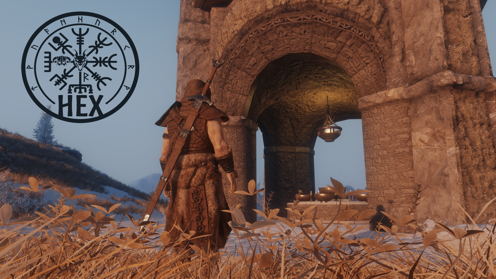

# HexRim
Skyrim, rebuilt with deeper systems and mechanics. Same game you know, just a whole lot more going on under the hood.

**Links**: [Changelog](changelog.md) | [Discord](https://discord.gg/bottled)

---

**Support**: Come join the [HexRim Discord](https://discord.gg/bottled). That's where I hang out and it's the fastest way to get help.

**Requirements**:
- Skyrim version 1.6.1170 (latest Steam update).
- Skyrim AE with all of the Anniversary Edition content (the paid Creation Club stuff).
- Around 250 GB of free SSD space and a PC that can handle it, see [Size and Performance](#size-and-performance).

---

## Contents
- [Introduction](#introduction)
- [What's in the List](#whats-in-the-list)
- [Size and Performance](#size-and-performance)
- [Stuff I Made for HexRim](#stuff-i-made-for-hexrim)
- [Installation](#installation)
- [Post-Installation](#post-installation)
- [Playing the Game](#playing-the-game)
- [Making It Yours](#making-it-yours)
- [Updating](#updating)
- [Uninstalling](#uninstalling)
- [Troubleshooting](#troubleshooting)
- [Credits](#credits)

---

## Introduction
HexRim is what BottleRim (Et' Ada) turned into. I wanted a true Skyrim remaster, not a pile of new content stapled on top of the game. Everything you know is still here, it's just been rebuilt with deeper systems and mechanics so it plays like the remaster we never got.

If you're coming from BottleRim, the biggest change is that SimonRim is gone. The list now runs on Paths of Empyrean for perks and magic, with Blade and Blunt and Deflection handling combat.

Licensed under [CC BY-NC-SA 4.0](http://creativecommons.org/licenses/by-nc-sa/4.0/).

---

## What's in the List
These are some of the bigger pieces. It's 1100+ mods, so this is nowhere near everything.

- **Perks, magic and leveling**: Paths of Empyrean for perks, Gods and Worship so the divines and daedra actually matter, Lost Grimoire plus a bunch of Kittytail's spell packs, and Leveling Freedom if you want to tweak the XP curve.
- **Combat**: Blade and Blunt plus Deflection (running my own HexRim settings), Wounds, Headshots Kill, NPCs that take cover instead of standing there, and enemies that actually use potions and poisons.
- **A world that changes**: Skyrim Realistic Conquering, Fort Takeovers and Civil War Overhaul Redux, so holds and forts change hands as the war plays out. The Environs and Juniper's mods let places get fixed up and lived in over time, Castle Volkihar can be rebuilt, the Thieves Guild gets a proper headquarters and towns celebrate holidays.
- **Towns and cities**: Cities of the North for Dawnstar, Morthal, Falkreath and Winterhold, the Great Towns and Villages series (Ivarstead, Karthwasten, Shor's Stone, Kynesgrove, Rorikstead and more), Lund's Hamlet and Obscure's College of Winterhold.
- **Quests and jobs**: Missives, Headhunter, Andrealletius Jobs Overhaul, Become a Bard, a big stack of vanilla quest expansions, Saints and Seducers Extended Cut and Thieves Guild Plus Plus. Quests award perk points too.
- **Survival and roleplay**: Survival Mode Improved, diseases that actually matter (Oregon and Canis Hysteria), Sacrilege vampires, Growl werewolves, Stress and Fear, an evolving economy, and location based encounter zones so dangerous places stay dangerous no matter what level you are.
- **Looks and sound**: my own Community Shaders build, PBR across the board, Lux and Lux Orbis lighting, NAT III weathers, Nature of the Wild Lands, Common Clothes and Armors with SMP physics, and Audio Overhaul for Skyrim with Immersive Sounds Compendium and a ton of regional soundscapes.

---

## Size and Performance
HexRim is a big, heavy list. Give this a look before you commit to a 154 GB download.

**List size**:
- 1,159 mods and 1,157 plugins (139 full plugins and 1,018 light plugins).
- About 92 GB installed and about 154 GB of downloads.
- Plan on roughly 250 GB of free SSD space for the install and the downloads together. Keep the downloads folder around after installing, Wabbajack only grabs what changed when you update.

**Performance**:
Community Shaders, PBR on just about everything, Lux lighting and a ton of scripted systems all add up. I build and test HexRim on an i5-13600KF, an RTX 4070 (12 GB) and 32 GB of RAM.

| | Minimum | Recommended |
|---|---|---|
| **GPU** | 8 GB of VRAM (RTX 3060 Ti / RX 6650 XT) | 12 GB or more of VRAM (RTX 4070 / RX 7800 XT or better) |
| **CPU** | 6 cores (Ryzen 5 5600 / i5-12400) | Ryzen 7 7700 / i5-13600K or better |
| **RAM** | 16 GB | 32 GB |
| **Storage** | SSD | NVMe SSD |

- The minimum gets you 1080p with some settings turned down. 1440p wants the recommended setup, and 4K wants 16 GB of VRAM or more.
- Struggling for frames? Open the Community Shaders menu with **Page Up** and turn down the heavier effects first.
- Do the pagefile step in [Pre-Installation](#pre-installation) no matter what your specs are.

---

## Stuff I Made for HexRim
A lot of this list is my own work, either mods I wrote or fixes for mods that were holding the list back.

- **Bottled Shaders**: my own Community Shaders build with a ton of custom additions. It's a big part of why HexRim looks the way it does.
- **Common Clothes and Armor SMP**: physics for the clothes and armor from Common Clothes and Armors.
- **Shadow Scene Node Crash Fix**: fixes a set of crashes when loading cells with certain lights.
- **More of my SKSE fixes in the list**: Rain Splashes SKSE, Interior DALC Fix, GC Bug Fix, LOD Refresh Bug Fix, First Person FOV and Tween Menu Fix, ISL Helper SKSE and CS Lights. I also brought PAPER and Steelfeathers' Papyrus Extensions up to NG so they work across game versions.
- **HexRim Conflict Resolution**: my hand made conflict patch for the whole list. I also cleaned up the stuff DynDOLOD kept yelling about, like deleted references, a broken College of Winterhold script and a dead ore vein script.

---

## Installation

### Pre-Installation
1. **Install Dependencies**:
   - [Visual C++ x64](https://aka.ms/vs/17/release/vc_redist.x64.exe). If you already have it, use the `Repair` option.
   - [.NET Runtime 8.x.x Desktop x64](https://dotnet.microsoft.com/en-us/download/dotnet/thank-you/runtime-desktop-8.0.15-windows-x64-installer).
   - [.NET Runtime 6.0.0 Desktop x64](https://dotnet.microsoft.com/en-us/download/dotnet/thank-you/runtime-desktop-6.0.30-windows-x64-installer).

2. **Steam Setup**:
   - Disable [auto-updates for Skyrim AE](https://help.steampowered.com/en/faqs/view/71AB-698D-57EB-178C#disable).
   - Run Skyrim through Steam once so it detects your graphics settings and downloads ALL of the Creation Club add-ons. Don't Alt-Tab while it's doing this.
   - If Creation Club plugins end up missing, I highly recommend a clean install of Skyrim. Uninstall it and delete the Skyrim Steam folder completely.

3. **Pagefile**:
   Big lists use a lot of memory and running out of it means crashes. Highly recommend doing this.
   - Press Win + R, type `sysdm.cpl ,3` and hit Enter.
   - Under Performance, click Settings, then open the Advanced tab.
   - Under Virtual Memory, click Change and uncheck "Automatically manage".
   - Pick your fastest SSD, choose Custom size and set both Initial and Maximum size to `40960` MB.
   - Click Set, then OK, then restart your PC.

### Wabbajack Installation
1. **Install Wabbajack**:
   - Make a folder (e.g., `C:\Wabbajack`) at the root of a drive (not in Program Files, Desktop, etc.).
   - Download [Wabbajack](https://github.com/wabbajack-tools/wabbajack/releases/latest/download/Wabbajack.exe) and put it in that folder.
   - Run `Wabbajack.exe` (needs version 4.0.0.0 or later).

2. **Install HexRim**:
   - Open Wabbajack, select Skyrim AE, find HexRim and click "Download and Install".
   - Set an Installation Location (e.g., `C:\HexRim`) and a Downloads Location (again, avoid Program Files, Desktop, etc.).
   - Click Install.
   - Nexus Premium automates the downloads. Without it you'll have to click "Slow Download" for each mod.
   - If it finishes, head to [Post-Installation](#post-installation). If something goes wrong, check [Troubleshooting](#troubleshooting).

### Antivirus Exceptions
- Add exceptions in Windows Defender for the HexRim folder and `ModOrganizer.exe`, it saves you some random crashes.
- Windows Security > Virus & Threat Protection > Manage Settings > Exclusions > Add Folder > select the HexRim folder.

---

## Post-Installation
A couple of things worth knowing before you jump in.

1. The Community Shaders menu opens with **Page Up**.
2. CS Lights is in the Lighting separator. If you want different options than what I picked, just reinstall it however you like.
3. On an ultrawide? Check the UltraWide separator in MO2.

---

## Playing the Game
- Launch Skyrim through Mod Organizer 2 (MO2) in your HexRim folder.
- Skyrim Unbound Reborn is the alternate start, so you get to choose how your story begins instead of riding the cart into Helgen again.

### I built HexRim so the world keeps moving while you're out doing Dragonborn stuff. Holds change hands as the civil war plays out, forts get taken, abandoned places get fixed up and lived in, and the gods actually care whether you worship them. I wanted your choices to have weight and the world to feel like it's changing with or without you.

Enjoy, or don't, it gets pretty rough out there.

---

## Making It Yours
There are a couple of mods in the MCM you should check out to set things up how you like.

- **Helmet Toggle 2**: awesome mod, set the hotkey and conditions in the MCM to whatever you want.
- **Leveling Freedom**: if you want to change how much XP it takes to level, find this in the MCM. You can adjust the curve yourself or just pick an easier or harder preset.

---

## Updating
1. Open Wabbajack, find HexRim and click "Download and Install".
2. Use the same Installation and Downloads folders.
3. Back up any custom mods or settings first (put **[NoDelete]** in front of the name of any mod you added in MO2).
4. Check the [Changelog](changelog.md) before updating, I always say whether an update is save-safe or not.

---

## Uninstalling
- Delete the HexRim folder. That's it.

---

## Troubleshooting
- **Installation Issues**:
  - Missing files? Download them manually and drop them in your Downloads folder.
  - Game folder not found? Make sure Skyrim is installed and go through [Pre-Installation](#pre-installation).
  - Antivirus flagging files? Add exceptions or uninstall aggressive third-party antivirus (looking at you, Norton).

- **Post-Installation Issues**:
  - Form 43/DLL errors? Reinstall with "Overwrite Installation" checked in Wabbajack.
  - Crashing on startup? Reinstall, or come ask for help in the [Discord](https://discord.gg/bottled) with your crash logs.

---

## Credits
- [ElminsterAU](https://www.patreon.com/ElminsterAU) & the xEdit team for SSEEdit.
- [Noggog](https://www.nexusmods.com/skyrim/users/862590) for Mutagen and Synthesis.
- [Halgari](https://www.nexusmods.com/skyrimspecialedition/users/17252164) & the Wabbajack team.
- Steelfeathers and SeaSparrow for Paths of Empyrean, and Steelfeathers for Gods and Worship.
- doodlum and the Community Shaders team, Bottled Shaders wouldn't exist without them.
- [Althro](https://github.com/Althro) and [Styyx](https://github.com/Styyx1) for ADT, which is the best base to build off of.
- [Bingus](https://github.com/bingusthecatto) for Anvil's epic readme that I used as a base for my own.
- [Sheson](https://ko-fi.com/sheson) for DynDOLOD.
- All mod authors and the Skyrim modding community.
